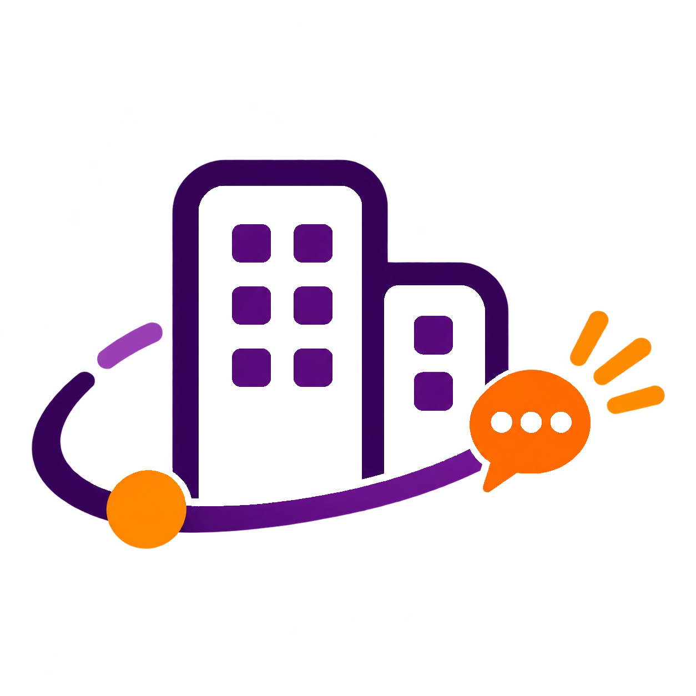

# Moravía

**Plataforma web para la gestión cotidiana de comunidades de vecinos autogestionadas**

## Índice

- [Descripción](#descripción)
- [Alcance del proyecto](#alcance-del-proyecto)
- [Tecnologías](#tecnologías)
- [Documentación de la propuesta](#documentación-de-la-propuesta)
- [Equipo y planificación](#equipo-y-planificación)
- [Consulta del repositorio](#consulta-del-repositorio)

## Descripción

Proponemos Moravía como aplicación web mobile-first para organizar incidencias en comunidades de vecinos autogestionadas. Queremos facilitar el seguimiento cuando la información queda repartida entre mensajes, llamadas y avisos. El proyecto se presentó inicialmente como VecinHub; desde el 19 de noviembre de 2026 utilizamos el nombre Moravía. Mantenemos el stack MERN: MongoDB, Express, React y Node.js.

## Alcance del proyecto

Al principio planteamos acceso, comunidades y viviendas, invitaciones QR, incidencias con fotos y mensajes, avisos y consultas. Ahora proponemos empezar por el acceso seguro y un recorrido completo de incidencias, con cuentas y comunidades de prueba. Dejaríamos los avisos como opción secundaria y el resto para más adelante. Tenemos que hablarlo entre nosotros y consultarlo con el profesorado. Explicamos los motivos en [objetivos y alcance](docs/objetivos-alcance.md).

## Estado actual — 19 de noviembre de 2026

En `develop` conservamos la documentación inicial; aún no contamos ahí con una aplicación ejecutable. Rocío comenzó la arquitectura de la información y los wireframes en Figma durante el Sprint 1, aunque no completamos el objetivo técnico de esa semana. Las ramas de backend contienen código, modelos y autenticación con pruebas propuestas en las [PR #40](https://github.com/Lmrocio/VecinHub/pull/40) y [#41](https://github.com/Lmrocio/VecinHub/pull/41), aún abiertas y pendientes de revisión e integración. Consulta la [planificación](docs/recursos.md#2-estimación-y-calendario) y el [seguimiento](docs/seguimiento/README.md).

Prevemos publicar la aplicación y preparar CI/CD para la entrega. Todavía no tenemos URL de producción ni capturas. Las instrucciones de instalación irán aquí cuando integremos una versión ejecutable.

## Tecnologías

| Capa | Tecnología prevista | Función |
|---|---|---|
| Interfaz | React y Tailwind CSS | Componentes y diseño adaptable a dispositivos móviles. |
| Servidor | Node.js y Express | API REST, autenticación y control de acceso. |
| Datos | MongoDB y Mongoose | Almacenamiento y modelado de los datos de la aplicación. |
| Servicios | Vercel, Render y MongoDB Atlas; Cloudinary aplazado | Despliegue previsto, base de datos y almacenamiento de imágenes. |

Las versiones de referencia, los límites de los servicios y las decisiones técnicas se detallan en [recursos](docs/recursos.md) y [viabilidad técnica](docs/viabilidad-tecnica.md).

## Documentación de la propuesta

| Documento | Criterio | Contenido |
|---|---|---|
| [Problema y propuesta de valor](docs/problema.md) | 2a | Necesidad identificada, usuarios, investigación exploratoria y análisis de alternativas. |
| [Viabilidad técnica](docs/viabilidad-tecnica.md) | 2b | Requisitos priorizados, arquitectura, modelo de datos, capacidades y riesgos. |
| [Objetivos y alcance](docs/objetivos-alcance.md) | 2d | Objetivos SMART, MVP, exclusiones y criterios de éxito. |
| [Recursos y organización](docs/recursos.md) | 2e | Responsabilidades, calendario, herramientas y servicios. |
| [Diseño](docs/diseno/README.md) | UX | Arquitectura de la información y wireframes iniciales. |
| [Entregables académicos](docs/entregables-academicos.md) | Proyecto | Estado de los documentos y requisitos de entrega. |
| [Seguimiento semanal](docs/seguimiento/README.md) | Seguimiento | Plantilla del profesor y revisiones de la semana previa y los seis sprints. |

## Equipo y planificación

| Integrante | Responsabilidades principales |
|---|---|
| **Rocío Luque Montes** | Diseño de interfaz y experiencia de usuario, frontend y pruebas de interfaz. |
| **Pablo Sanz Aznar** | Backend, base de datos, integraciones y despliegue. |

Compartimos la integración, las pruebas, la revisión de cambios y la documentación. Contamos con autorización excepcional para trabajar en pareja. Tenemos previstos seis sprints semanales entre el 9 de noviembre y el 18 de diciembre de 2026, con un presupuesto original de 72 horas-persona, incluidas 8 de reserva. Cada viernes decidiremos y podremos modificar el reparto según la disponibilidad.

## Consulta del repositorio

Los documentos pueden abrirse directamente desde la tabla anterior en GitHub. Para consultarlos en local, clona el repositorio con su URL desde el botón **Code** de GitHub y abre la carpeta en un editor compatible con Markdown, como VS Code.

La carpeta `docs/` contiene la propuesta. El calendario de desarrollo y el flujo de trabajo previsto están descritos en [recursos y organización](docs/recursos.md).

Usamos [GitHub Projects](https://github.com/users/Lmrocio/projects/10) para organizar las tareas. Nos falta comprobar el acceso y el contenido de la Wiki antes de enlazarla.
