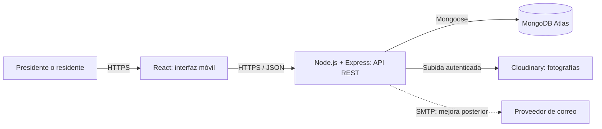
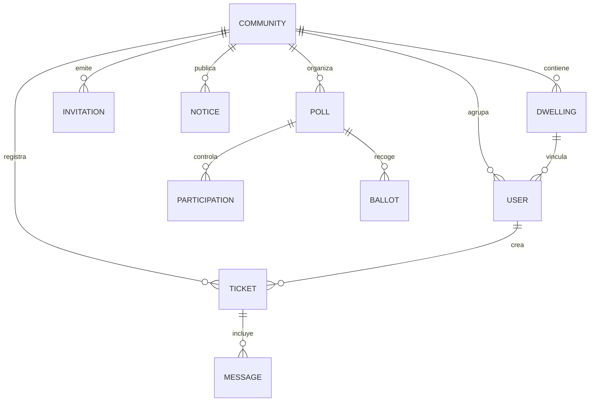

# Viabilidad técnica

## Índice

- [1. Requisitos funcionales y prioridades](#1-requisitos-funcionales-y-prioridades)
- [2. Arquitectura y decisiones técnicas](#2-arquitectura-y-decisiones-técnicas)
- [3. Modelo preliminar de MongoDB](#3-modelo-preliminar-de-mongodb)
- [4. Capacidades y viabilidad](#4-capacidades-y-viabilidad)
- [5. Riesgos y mitigación](#5-riesgos-y-mitigación)

## 1. Requisitos funcionales y prioridades

**Revisión propuesta el 19 de noviembre de 2026:** conservamos el diseño original más abajo como referencia. Debemos acordar la reducción y consultarla con el profesorado. Prepararemos al menos dos comunidades ficticias con usuarios, viviendas y recursos separados para comprobar el aislamiento; aún debemos concretar el procedimiento sin permitir autoasignación de rol ni pertenencia.

| ID original | Prioridad propuesta | Resultado |
|---|---|---|
| F1 | Parcial | Inicio de sesión y datos de comunidad/vivienda preparados; registro y creación pública aplazados. |
| F2 | Aplazado | Invitaciones, QR y validación de residentes. |
| F3 | Esencial parcial | Crear y consultar incidencias sin fotografías. |
| F4 | Esencial | Consultar incidencias y cambiar estado con rol autorizado. |
| F5 | Aplazado | Mensajería privada. |
| F6 | Secundario | Avisos, solo con capacidad adicional. |
| F7 | Aplazado | Consultas y votaciones. |
| F8 | Esencial | Comprobar sesión, rol, comunidad y recurso en servidor; interfaz adaptable. |
| F9–F12 | Posterior | Notificaciones, filtros, QR, tiempo real y demás ampliaciones. |

Mantendremos validación de entradas, hash de contraseñas y protección de sesión. Una invitación por sí sola no prueba residencia; antes de habilitar incorporación real necesitaremos un mecanismo de validación.

## 2. Arquitectura y decisiones técnicas

El siguiente esquema refleja también servicios y funciones aplazadas; para el recorrido reducido no necesitamos Cloudinary ni correo.

React permite una SPA basada en componentes y vistas reactivas adaptadas al móvil; React Router organiza pantallas; Tailwind CSS permite construir una interfaz adaptable. El estado local y Context cubren sesión y datos compartidos; `fetch` evita añadir un gestor de estado o cliente HTTP sin necesidad inicial. Node.js utiliza entrada y salida asíncrona no bloqueante; Express expone una API REST ligera, valida entradas y aplica autorización en servidor. JWT de corta duración en cookie `HttpOnly`, `Secure` y `SameSite`, junto con protección CSRF apropiada, limita la exposición de la sesión; las contraseñas se almacenan con hash y sal mediante bcrypt. Las claves y credenciales se guardan como variables de entorno, nunca en Git. El detalle de versiones y servicios figura en [recursos](recursos.md).

Los mensajes se recuperan al abrir o actualizar la incidencia; no se promete entrega en tiempo real. Las imágenes requieren validación de tipo y tamaño en servidor y acceso restringido mediante entrega autenticada o URLs firmadas de corta duración; una URL pública permanente no cumple la privacidad prevista. Si no se puede configurar esta protección, se desactiva la subida hasta resolverla. El servidor no conserva archivos en disco como almacenamiento permanente.

## 3. Modelo preliminar de MongoDB

Conservamos el modelo original como diseño preliminar. Invitaciones, mensajes, fotos, avisos y votaciones no forman parte del núcleo propuesto; no debemos interpretar el diagrama como implementación terminada.

| Colección | Campos principales y tipos | Reglas |
|---|---|---|
| `communities` | `_id: ObjectId`, `name: String`, `address: String`, `presidentId: ObjectId`, `createdAt: Date` | Presidente referencia a usuario de la comunidad. |
| `dwellings` | `_id`, `communityId: ObjectId`, `label: String` | Índice único `(communityId, label)`. |
| `users` | `_id`, `communityId`, `dwellingId: ObjectId`, `name`, `email`, `passwordHash`, `role`, `membershipStatus: String` | Correo único normalizado; rol presidente/vecino; alta pendiente o validada. |
| `invitations` | `_id`, `communityId`, `tokenHash: String`, `expiresAt: Date`, `revokedAt: Date/null` | Token aleatorio, hash almacenado y caducidad comprobada en cada uso; TTL solo para limpieza. |
| `tickets` | `_id`, `communityId`, `authorId: ObjectId`, `title`, `description`, `category`, `status: String`, `imageId: String/null`, `createdAt: Date`, `messages: Array` | Mensaje embebido: `authorId: ObjectId`, `body: String`, `createdAt: Date`; limitar tamaño y paginar o extraer a colección si crece. Índice por comunidad y estado. |
| `notices` | `_id`, `communityId`, `authorId: ObjectId`, `title`, `body: String`, `createdAt: Date` | Solo publica el presidente; lectura limitada a miembros. |
| `polls` | `_id`, `communityId`, `authorId: ObjectId`, `question: String`, `options: Array<{id: String, label: String}>`, `closesAt: Date`, `status: String` | Opciones inmutables después del primer voto; cierre efectivo comprobado en servidor. |
| `participations` | `_id`, `pollId`, `dwellingId: ObjectId` | Índice único `(pollId, dwellingId)` impide duplicados. No contiene opción. |
| `ballots` | `_id`, `pollId: ObjectId`, `optionId: String` | No contiene usuario ni vivienda; se cuenta por opción tras cerrar. |

Los documentos agrupan datos que se consultan juntos, como mensajes acotados de una incidencia; las entidades compartidas se referencian para evitar duplicación. El voto y la participación se insertan con `session.withTransaction` en una transacción MongoDB: si falla una operación, se revierten ambas; el índice único resuelve solicitudes simultáneas. Se comprueban pertenencia, vivienda validada, estado y plazo dentro del flujo de votación. Se prueban concurrencia y reversión con un despliegue compatible con transacciones.

**Límite de privacidad:** separar colecciones evita un vínculo directo, pero no garantiza anonimato frente a administradores, registros, marcas temporales o correlación de operaciones; en grupos pequeños también puede deducirse una respuesta del recuento. No registrar contenido ni marcas temporales innecesarias, mostrar resultados solo al cierre y comunicar esta limitación. No afirmar anonimato absoluto. Para garantías más fuertes se necesitaría un diseño y auditoría específicos fuera de este MVP.

### Justificación del modelo NoSQL frente a relacional (SQL)

MongoDB permite guardar los mensajes acotados dentro del ticket y recuperar la incidencia completa en una lectura sin unir tablas. Las opciones de una consulta se modelan como un array, sin una tabla intermedia, y los documentos BSON se corresponden de forma natural con los objetos intercambiados en JSON por Express y React. La fragmentación permite escalar horizontalmente en otros niveles de servicio, aunque Atlas Free no la admite.

Estas ventajas dependen del patrón de acceso: SQL también puede modelar mensajes y opciones con garantías sólidas, y un JOIN no es necesariamente costoso. La velocidad debe medirse, no suponerse. El límite de tamaño de los documentos exige acotar los mensajes o extraerlos a una colección cuando crezcan.
## 4. Capacidades y viabilidad

Rocío tiene un nivel general de desarrollo de 3/5 y de 4,5/5 en diseño, maquetación, UX y accesibilidad. Pablo tiene un nivel general de 2,5/5 y de 1,5/5 en diseño/CSS y despliegue. La escala es orientativa: 1 representa conocimientos iniciales y 5 dominio avanzado. Los niveles generales no equivalen a una valoración independiente de cada herramienta.

| Tecnología / área | Rocío (1–5) | Pablo (1–5) | Laguna y estrategia semanal |
|---|---:|---:|---|
| Diseño, maquetación, UX y accesibilidad | 4,5 | 2,5 | Rocío guía una revisión semanal de accesibilidad y diseño adaptable. |
| React y desarrollo frontend | 3 (general) | 2,5 (general) | Practicar componentes, formularios y rutas mediante una tarea conjunta por sprint. |
| Node, Express y seguridad | 3 (general) | 2,5 (general) | Revisar semanalmente una ruta y sus pruebas de autorización. |
| MongoDB y Mongoose | 3 (general) | 2,5 (general) | Revisar modelos, índices y acceso a los datos de cada comunidad. |
| Despliegue | 3 (general) | 2,5 | Colaborar en el despliegue público y la automatización. |
Mantenemos seis sprints y la entrega prevista para el 18 de diciembre. La nueva estimación supera el presupuesto original de 72 horas-persona; debemos ajustar alcance o capacidad. Cada viernes decidiremos y podremos modificar el reparto.
## 5. Riesgos y mitigación

| Riesgo | Probabilidad / impacto estimados | Mitigación y comprobación |
|---|---|---|
| Acceso a datos de otra comunidad | Media / alto | Comprobar autorización en cada consulta y probar con dos comunidades ficticias. |
| Credenciales o sesión expuestas | Media / alto | Hash de contraseñas, cookies seguras, CSRF y pruebas de acceso no autorizado. |
| Despliegue público o CI/CD bloqueados | Media / alto | Preparar servicios y automatización pronto; consultar alternativas con el profesorado. |
| Plazo o carga del equipo insuficientes | Alta / alto | Medir horas y avance semanal; priorizar el recorrido reducido y ajustar alcance o plazo. |
| Límites o parada de servicios gratuitos | Media / medio | Vigilar almacenamiento y transferencia, generar alertas, limitar cargas y preparar demostración local con datos ficticios. |

Si retomamos invitaciones, imágenes o votaciones, volveremos a revisar los riesgos de enlaces compartidos, exposición de fotografías, votos duplicados y privacidad descritos en el modelo anterior.
